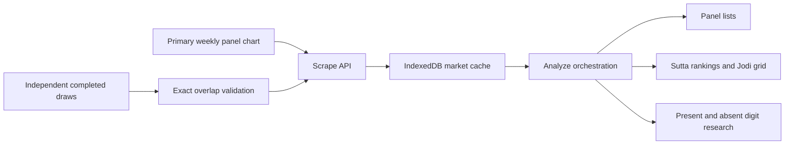

# Current project map

Reviewed on October 13, 2026 against app 1.0.25. This map covers the production entry points, prediction paths, persistence, API routes, notification lifecycle, research comparisons, and release checks. Historical experiments are summarized by their decision reports; this is not a claim that every archived exploratory script or external service was independently validated.

## Product and deployment

Lakshmi Boss is a Next.js 16.2.6 App Router application using React 19.2.4, TypeScript, Tailwind 4, and component-oriented global CSS. `src/app/page.tsx` is a client entry point with Calculator, Analysis, and Live Results tabs. Analysis and Live Results load dynamically without server rendering. A `#live-results` link selects the results tab. The profile drawer holds the app version, update controls, and bet-format converter.

`src/app/layout.tsx` supplies metadata, manifest and icons, captures the browser install event early, and mounts the service-worker registration and install prompt. The primary style direction is a dark mobile calculator/dashboard with Outfit and Inter fonts. Styles are divided between base, calculator, shell, analysis, and live-results files; this review does not propose a redesign.

The Next.js configuration and Vercel configuration explicitly prevent caching of the service-worker script and manifest. Build uses the installed Next.js CLI with webpack. Installed framework guides, rather than older generic Next.js examples, govern framework changes.

## Draw contract and calculator

A complete market-day contains an Open panel, Open Sutta, Jodi, Close panel, and Close Sutta. Each Sutta is the corresponding panel's digit sum modulo ten. Jodi concatenates the two Suttas. Canonical panel ordering treats zero as the last digit. The legal universe contains 220 panels: 120 SP, 90 DP, and 10 TP.

Calculator modes are SP, DP, TP, MPSP, and MPDP. Sutta selections filter the canonical universe. Multi-panel modes additionally restrict every panel digit to the selected digit set. Each common-digit input requires at least one match from that input. The calculator returns matched and excluded panels separately and copies the exact numbers with hyphens. It is combinatorial filtering, not a trained predictor.

`bet-copy-format.ts` supports separators and text styles persisted in local storage. The converter preserves the sequence of numeric tokens, including leading zeros, and checks that formatting has not changed those tokens.

## Historical data pipeline

`/api/scrape` permits the configured primary chart hosts, fetches without HTTP caching, parses weekly HTML rows into Open/Jodi/Close triplets, and preserves partial Open-only records. Primary requests have a nine-second abort; independent requests have seven seconds. A primary fetch failure fails the request. An independent fetch failure leaves primary history available.

The independent source is mapped for eleven markets. Rajdhani Day is deliberately excluded. `panel-history-supplement.ts` validates dates, canonical panels, and Jodi sums. It requires at least twenty overlapping complete draws and exact agreement on every overlap before filling missing dates. Primary records win duplicates; independent additions must match an observed market weekday. Independent data is supplementary, not authority to overwrite primary outcomes.

`prediction-contract.ts` currently specifies a 28-calendar-month history window, six Suttas, a 36-pair default Jodi grid, and ten displayed exact panels. The window is anchored to the newest available chart date, not necessarily today. The two-year research snapshot is a separate, narrower experimental dataset.

`db.ts` stores market/week/day records in IndexedDB `dbboss_v2`, store `panels`. It upserts by the record id and retrieves chronologically sorted records. Calendar dates are reconstructed from the weekly Monday and weekday offset. History filtering occurs on write and read; older physical entries are not automatically deleted. A force refresh clears the selected market before fetching.

`market-history-freshness.ts` checks six-hour age, coverage of the configured window, and missing scheduled results after a ten-minute grace period in IST. It infers regularly closed weekdays from recent history and handles Main Bazar's Close after midnight. Schedule order is not proof of historical publication time.

Analysis first loads the selected market, then other cached markets, then refreshes required Sutta source markets. It stores the resulting inputs in state and refs, calls `analyzeMarket`, and computes a 30-day replay. Fetch or dependency failure currently puts the entire analysis in an error state.

## Prediction paths actually used

| Output | Active model | Inputs and conditions |
| --- | --- | --- |
| Open exact panels | `panel-top10-v1` conditional logit | Same-market completed draws; 22 panel features; minimum 50 complete draws |
| Close exact panels before Open | Legacy scorer/profile routing | Close history, operator adjustments, market routing |
| Close exact panels after exact Open is known | `panel-top10-v1` live Close conditional logit | Prior completed draws plus declared own Open panel |
| Open Sutta | `v2-recency` | Completed prior-date Open results, minimum 31 draws |
| Close and adjusted Close Sutta | `v2-recency` | Prior-date results; suppress previous Close/Open digits, then sort remaining digits by 30-draw Close frequency |
| Jodi | Cartesian grid | Six ranked Open digits times six ranked Close digits by default |
| DP panel lists | `dp-panel-clogit-v3` | Conditional distribution over 90 DP panels; 19 own/pooled history features, optional known own Open |
| Verified DP call | Closed gate | Always abstains because no frozen 90%-precision rule has qualified |
| Absent digit pair | Guarded online V3 with V2 fallback | Completed prior draws, appearance and joint-absence experts, historical performance guard |
| Present digit pair | Joint co-appearance V1 | Both digits must occur in one panel; 180-draw frequency and causal reliability replay |

`analyze.ts` remains the orchestrator. It computes descriptive statistics, droughts, volume/liquidity/calendar context, operator panel adjustments, raw Open/Close picks, displayed panel lists, DP lists, and diagnostic kind forecasts. Raw `openPicks`/`closePicks` remain distinct from displayed `openPanelPicks`/`closePanelPicks`. The former retain thirty scorer picks; the latter contain ten panels.

The learned Top-10 model uses panel kind, frequency, gap, digit/pair/sum geometry, Sutta frequency/gap, weekday frequency, previous-panel overlap, opposite-digit overlap, and conditional Sutta frequency. Its deployed weights were fitted through July 2, 2026. It does not require other markets. `applyPanelOrder` changes the order while retaining the heuristic score envelope. Those displayed scores are not calibrated exact-panel probabilities, and their breakdown describes the original scorer rather than the learned ordering.

`production.ts` selects the recency Sutta engine first and uses legacy market-routed strategies only if recency cannot obtain enough completed history. Copy counts slice one complete ranking. The UI allows one through ten digits, so larger lists mechanically increase coverage. Recency ignores today's known Open for Close Sutta because that addition did not show a reliable advantage. Exact Close panels still condition on known Open.

`jodi.ts` computes conditional Open-to-Close frequencies and conservative historical penalties for the raw Close scorer. An exact Open panel additionally triggers operator reaction and the learned live Close panel ranking. A Sutta-only input cannot use exact-panel features and retains the heuristic Jodi panel order.

The DP panel model's probabilities are conditional on a DP occurring. They are not the probability that the next result will be DP. Its target date can advance to the next day once today's complete result exists. The older kind forecast uses multipliers and mined overrides; it is not the verified DP call gate. The legacy `PanelKind` type groups TP with SP in some diagnostics, whereas research scoring treats TP separately.

The absent pair succeeds only when both digits are absent. V3 routes require at least 60 prior route comparisons, a net gain of at least two over the last 80, and a nonnegative last-40 gain; otherwise V2 remains the ranking. Expert losses update after each historical outcome. Confidence uses local beta shrinkage. A call requires a sufficiently supported Wilson lower bound of 80%, which ordinarily leaves the gate closed. Present pairs remain research-only unless their Wilson lower bound reaches 70%.

## UI evaluation and confidence

The Analysis tab has picks, stats, and intelligence views; Open, Close, and Jodi subviews; present/absent pairs; and a Bet Copy desk. Model analysis runs in the browser. Manual known-Open inputs call `computeJodiAnalysis` against the cached history and retained context.

The displayed seven-day Sutta accuracy replays prior-date history and scores the actual current Sutta selector. The separate 30-day panel replay scores displayed ten-panel lists. Its Close comparison supplies the day's known Open; it must not be described as a before-Open forecast. Older `suttaTopN` fields in that panel replay mean Suttas found among N panels, not the independent six-digit recency shortlist.

`calibration.ts` contains older fixed per-market Panel@30 and Sutta@30 values. The confidence widget still displays the former and falls back to the latter if live Sutta accuracy is absent. These numbers do not describe the current Top-10 panel or Top-6 Sutta contracts. Sutta `probabilityPct` comes from a relative score softmax and is not empirically calibrated success confidence. Recent seven-day percentages have small denominators.

## Live results and notifications

Live results use Supabase and are separate from browser history. `/api/live-results` reads today's active markets and persisted results using a server-only admin client. The client polls every minute while visible. Manual refresh is throttled against the latest monitor run and calls the protected monitor endpoint server-side.

The monitor authenticates with `RESULT_MONITOR_SECRET`, fetches the homepage once, validates Open/Close sums, and requires two consecutive identical observations before persistence. Uniqueness by market/date and result/phase/hash controls repeated writes and events. Close updates require agreement with a saved Open. Night results shortly after midnight can belong to the previous market date.

Supabase migrations create markets, results, result events, monitor candidates/runs, push subscriptions, preferences, indexes, update triggers, and row-level security. The later migrations configure the database cron and HTTP call using a stored secret. These are existing infrastructure; this review does not run migrations or change notification settings.

Push routes save/delete device subscriptions and provide a test delivery. VAPID keys stay on the server except the public key. Per-market Open/Close preferences determine recipients. Expired subscriptions are removed; repeated failures disable them. The service worker receives notifications and opens the live-results tab. No notification is sent as part of this accuracy research.

## PWA and release contract

The app owns `public/sw.js`; it is not generated by Workbox. Navigation and chart API requests use network-first caching, hashed app assets use cache-first, and fonts use stale-while-revalidate. Live-result/push/monitor requests bypass the API cache. A cached chart can be returned after a network failure, which is distinct from IndexedDB's freshness check.

The worker waits after installation. The profile update action posts `SKIP_WAITING`; a controller change reloads the page. Activation removes prior app-version cache names. Existing IndexedDB history is independent of the worker caches.

A production release must update all five files: `package.json`, both root version fields in `package-lock.json`, `src/lib/app-version.ts`, `public/manifest.json`, and `public/sw.js`. `verify-pwa-assets.cjs` runs before build and rejects mismatched versions or wrong icon sizes. Change the Sutta model version only if the Sutta model changes. A research-only result does not require an app/PWA version bump.

## Documentation differences and verified risks

| Finding | Evidence | Effect and next check |
| --- | --- | --- |
| Required source list still describes legacy Sutta rules | `getSuttaSourceMarketNames` plus the unconditional refresh in AnalysisSection | A source failure can block a recency prediction that needs only own-market history. Reproduce with sufficient own history and a failing source. |
| Target-day conventions differ | Recency/absent/freshness use IST; present pairs use UTC; legacy context and panel weekdays use local Date methods | Near midnight, outputs can use different dates. Test one instant under several process time zones before changing model boundaries. |
| Panel and Sutta histories differ after a complete same-day result | Top-10 `completeDraws` has no target cutoff; recency explicitly excludes the target date | Same-screen predictions can concern different effective draws. Define the prediction event first; do not claim an accuracy gain from retrospectively using a posted outcome. |
| Partial Opens are inferred from the latest record without a date check | `findDeclaredOpenPanel` | A stale trailing partial record can act as today's Open. Test an old partial row against the intended current event. |
| Primary chart parsing is less strict than independent normalization | `/api/scrape` extracts numeric panels; supplement validates independent panel/Jodi legality | Invalid primary dates/panels/Jodi can reach browser history. Count real source errors before proposing repair or rejection policy. |
| Historical confidence labels are stale | `ConfidenceBadge`, `calibration.ts`, current ten-panel contract | A Top-30 research number can accompany a Top-10 output. Confidence changes need tests against the actual current model, not another challenger. |
| V2 fixture replay used extra history | Existing V2 verifier versus frozen registry/source cutoff and 729-day lookback | Original baseline check failed at Sridevi Open confidence. Restricting the fixture to its original window and cutoff reproduced all 24 market-side forecasts without changing runtime. |

Old `prediction.md`, `analysis.md`, `DP-pattern.md`, and `task.md` contain operator-liability explanations, old hosts/counts, and old experimental claims. These are hypotheses and historical notes, not proof of how an operator selects outcomes. `sutta-prediction-model-notes.md` correctly marks the recency engine first, but its later sections describe legacy behavior. Old PWA instructions refer to Workbox and `sw-custom.js`, which are no longer the active release implementation.

## Research and promotion

The repository has already tried frequencies, shrinkage, geometry, transition tables, calendar formulas, cross-market schedules, neural and linear models, DP alerts, digit absence/presence, and portfolio restrictions. Many apparent gains reverse on later blocks. Production should be compared at a fixed shortlist size and on exactly the same market/date/event outcomes.

The frozen two-year study uses October 9, 2024 through October 8, 2026, with 7,279 complete draws and 5,119 scored market-days after a 180-draw warmup. Its production comparator is current code, not a historical deployment reconstruction. Existing panel weights include later fitting relative to some replay dates, so post-July-2 comparisons are reported separately. Missing source results are not invented.

The October 13 portfolio experiment tested fourteen alternatives plus production across 984 post-training market-days. July-August choices lost five Open and three live Close hits in September-October. Digit diversification and a soft avoided-digit penalty are exploratory leads with intervals including a loss. They do not justify a production ranking change.

The next experiment will refit panel rankers using the frozen two-year source and test nonlinear interactions with a small, fixed family. Training, selection, and later evaluation must remain chronological. Open never receives a target outcome; live Close may receive only its own declared Open. Reused dates must be labeled retrospective. If a candidate produces a credible gain, implement the same feature and ranking contract in TypeScript, verify runtime parity and the UI path, then bump and verify app/PWA versions before pushing each changed file separately.

Initial baseline: 25 of 26 checks passed across recency parity, Sutta ordering, calendar windows, cache freshness, absent/present runtime, two-year research/confidence, and portfolio verification. The sole failure was the frozen V2 fixture scope described above. Existing lint has seven warnings. Supabase deployment health and delivery were not exercised in this static/code review.
